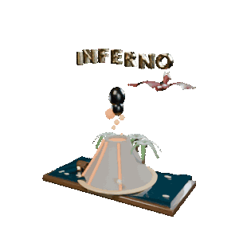
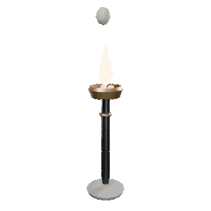
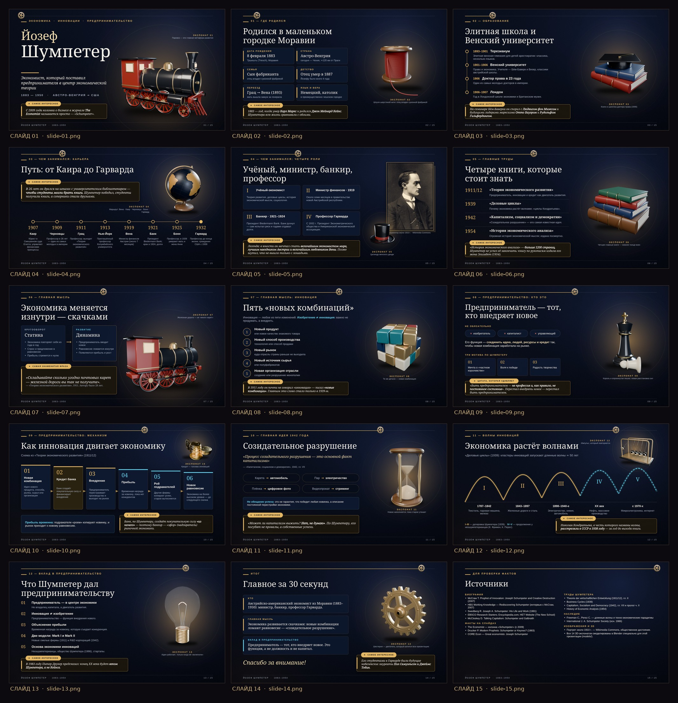
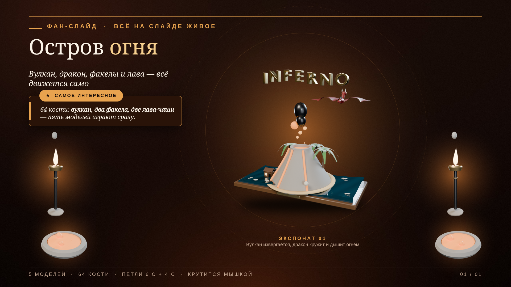

<div align="center">

<picture>
  <source media="(max-width: 600px) and (prefers-reduced-motion: reduce)" srcset=".github/assets/stage-cover-compact-still.svg">
  <source media="(max-width: 600px)" srcset=".github/assets/stage-cover-compact.svg">
  <source media="(prefers-reduced-motion: reduce)" srcset=".github/assets/stage-cover-still.svg">
  
</picture>

<br/>

<sub><b>МАСТЕРСКАЯ ПРОГРАММНЫХ 3D-СЦЕН ДЛЯ POWERPOINT 365 / 2021+</b> · ПРОЦЕДУРНЫЙ BLENDER GLB · ИНЪЕКЦИЯ OPENXML · БЕСШОВНЫЙ MORPH</sub>

<br/><br/>

<a href="AGENTS.md"></a>&nbsp;&nbsp;<a href="train-ai/"></a>&nbsp;&nbsp;<a href="presentations/"></a>&nbsp;&nbsp;<a href="exports/"></a>

</div>

---

## Зачем этот репозиторий

Обычный генератор слайдов кладёт на прямоугольник заголовок, три буллита и плоскую картинку. **MyWorkAiBrain** устроен иначе: здесь слайд трактуется как **театральная сцена с глубиной, светом, физикой костей и кулисами за пределами кадра**.

Репозиторий решает сразу две задачи:

1. **Учебник и плейбук для ИИ-агентов** ([`AGENTS.md`](AGENTS.md) + курс из 6 глав в [`train-ai/`](train-ai/)), по которому агент с первой попытки собирает валидный `.pptx` с живыми крутящимися и самодвижущимися `.glb`-моделями, не спотыкаясь о закрытые тонкости движка PowerPoint.
2. **Эталонная коллекция из 5 готовых спектаклей** ([«Примеры презентаций»](presentations/) в коде и [«Примеры экспорта»](exports/) в виде собранных `.pptx`, превью и текстов выступлений) — **42 слайда** и **49 трёхмерных моделей**, созданных процедурно на Python в Blender без единого стороннего ассета.

```diff
- Плоский слайд: статичный PNG на фоне шаблона и ручная расстановка фигур мышью
+ Живая сцена: процедурный .glb с единым скелетом + Cycles-постер + OpenXML am3d:model3d + Morph !!
```

---

## Потрогать 3D прямо здесь · интерактивный экспонат

GitHub умеет крутить твердотельную геометрию в браузере без плагинов. Ниже встроена водонепроницаемая модель **армиллярного компаса Morph** ($V = 94,\; E = 276,\; F = 184,\; \chi = 2$) — **зажмите левую кнопку мыши, покрутите сцену, приблизьте колесом и переключите режим `Wireframe`**:

```stl
solid myworkaibrain_armillary
  facet normal 0.0000 0.0000 -1.0000
    outer loop
      vertex 22.000 0.000 0.000
      vertex 15.000 0.000 0.000
      vertex 12.135 8.817 0.000
    endloop
  endfacet
  facet normal 0.0000 0.0000 -1.0000
    outer loop
      vertex 22.000 0.000 0.000
      vertex 12.135 8.817 0.000
      vertex 17.798 12.931 0.000
    endloop
  endfacet
  facet normal 0.9510 0.3090 0.0000
    outer loop
      vertex 22.000 0.000 0.000
      vertex 17.798 12.931 0.000
      vertex 17.798 12.931 4.200
    endloop
  endfacet
  facet normal 0.9510 0.3090 -0.0000
    outer loop
      vertex 22.000 0.000 0.000
      vertex 17.798 12.931 4.200
      vertex 22.000 0.000 4.200
    endloop
  endfacet
  facet normal 0.0000 0.0000 1.0000
    outer loop
      vertex 22.000 0.000 4.200
      vertex 17.798 12.931 4.200
      vertex 12.135 8.817 4.200
    endloop
  endfacet
  facet normal 0.0000 0.0000 1.0000
    outer loop
      vertex 22.000 0.000 4.200
      vertex 12.135 8.817 4.200
      vertex 15.000 0.000 4.200
    endloop
  endfacet
  facet normal -0.9511 -0.3090 0.0000
    outer loop
      vertex 15.000 0.000 0.000
      vertex 15.000 0.000 4.200
      vertex 12.135 8.817 4.200
    endloop
  endfacet
  facet normal -0.9511 -0.3090 0.0000
    outer loop
      vertex 15.000 0.000 0.000
      vertex 12.135 8.817 4.200
      vertex 12.135 8.817 0.000
    endloop
  endfacet
  facet normal -0.0000 0.0000 -1.0000
    outer loop
      vertex 17.798 12.931 0.000
      vertex 12.135 8.817 0.000
      vertex 4.635 14.266 0.000
    endloop
  endfacet
  facet normal 0.0000 0.0000 -1.0000
    outer loop
      vertex 17.798 12.931 0.000
      vertex 4.635 14.266 0.000
      vertex 6.798 20.923 0.000
    endloop
  endfacet
  facet normal 0.5878 0.8090 0.0000
    outer loop
      vertex 17.798 12.931 0.000
      vertex 6.798 20.923 0.000
      vertex 6.798 20.923 4.200
    endloop
  endfacet
  facet normal 0.5878 0.8090 -0.0000
    outer loop
      vertex 17.798 12.931 0.000
      vertex 6.798 20.923 4.200
      vertex 17.798 12.931 4.200
    endloop
  endfacet
  facet normal 0.0000 0.0000 1.0000
    outer loop
      vertex 17.798 12.931 4.200
      vertex 6.798 20.923 4.200
      vertex 4.635 14.266 4.200
    endloop
  endfacet
  facet normal 0.0000 0.0000 1.0000
    outer loop
      vertex 17.798 12.931 4.200
      vertex 4.635 14.266 4.200
      vertex 12.135 8.817 4.200
    endloop
  endfacet
  facet normal -0.5878 -0.8090 0.0000
    outer loop
      vertex 12.135 8.817 0.000
      vertex 12.135 8.817 4.200
      vertex 4.635 14.266 4.200
    endloop
  endfacet
  facet normal -0.5878 -0.8090 0.0000
    outer loop
      vertex 12.135 8.817 0.000
      vertex 4.635 14.266 4.200
      vertex 4.635 14.266 0.000
    endloop
  endfacet
  facet normal 0.0000 0.0000 -1.0000
    outer loop
      vertex 6.798 20.923 0.000
      vertex 4.635 14.266 0.000
      vertex -4.635 14.266 0.000
    endloop
  endfacet
  facet normal -0.0000 0.0000 -1.0000
    outer loop
      vertex 6.798 20.923 0.000
      vertex -4.635 14.266 0.000
      vertex -6.798 20.923 0.000
    endloop
  endfacet
  facet normal 0.0000 1.0000 0.0000
    outer loop
      vertex 6.798 20.923 0.000
      vertex -6.798 20.923 0.000
      vertex -6.798 20.923 4.200
    endloop
  endfacet
  facet normal 0.0000 1.0000 -0.0000
    outer loop
      vertex 6.798 20.923 0.000
      vertex -6.798 20.923 4.200
      vertex 6.798 20.923 4.200
    endloop
  endfacet
  facet normal 0.0000 0.0000 1.0000
    outer loop
      vertex 6.798 20.923 4.200
      vertex -6.798 20.923 4.200
      vertex -4.635 14.266 4.200
    endloop
  endfacet
  facet normal 0.0000 0.0000 1.0000
    outer loop
      vertex 6.798 20.923 4.200
      vertex -4.635 14.266 4.200
      vertex 4.635 14.266 4.200
    endloop
  endfacet
  facet normal 0.0000 -1.0000 0.0000
    outer loop
      vertex 4.635 14.266 0.000
      vertex 4.635 14.266 4.200
      vertex -4.635 14.266 4.200
    endloop
  endfacet
  facet normal 0.0000 -1.0000 0.0000
    outer loop
      vertex 4.635 14.266 0.000
      vertex -4.635 14.266 4.200
      vertex -4.635 14.266 0.000
    endloop
  endfacet
  facet normal 0.0000 -0.0000 -1.0000
    outer loop
      vertex -6.798 20.923 0.000
      vertex -4.635 14.266 0.000
      vertex -12.135 8.817 0.000
    endloop
  endfacet
  facet normal 0.0000 0.0000 -1.0000
    outer loop
      vertex -6.798 20.923 0.000
      vertex -12.135 8.817 0.000
      vertex -17.798 12.931 0.000
    endloop
  endfacet
  facet normal -0.5878 0.8090 0.0000
    outer loop
      vertex -6.798 20.923 0.000
      vertex -17.798 12.931 0.000
      vertex -17.798 12.931 4.200
    endloop
  endfacet
  facet normal -0.5878 0.8090 0.0000
    outer loop
      vertex -6.798 20.923 0.000
      vertex -17.798 12.931 4.200
      vertex -6.798 20.923 4.200
    endloop
  endfacet
  facet normal 0.0000 0.0000 1.0000
    outer loop
      vertex -6.798 20.923 4.200
      vertex -17.798 12.931 4.200
      vertex -12.135 8.817 4.200
    endloop
  endfacet
  facet normal 0.0000 0.0000 1.0000
    outer loop
      vertex -6.798 20.923 4.200
      vertex -12.135 8.817 4.200
      vertex -4.635 14.266 4.200
    endloop
  endfacet
  facet normal 0.5878 -0.8090 0.0000
    outer loop
      vertex -4.635 14.266 0.000
      vertex -4.635 14.266 4.200
      vertex -12.135 8.817 4.200
    endloop
  endfacet
  facet normal 0.5878 -0.8090 0.0000
    outer loop
      vertex -4.635 14.266 0.000
      vertex -12.135 8.817 4.200
      vertex -12.135 8.817 0.000
    endloop
  endfacet
  facet normal 0.0000 0.0000 -1.0000
    outer loop
      vertex -17.798 12.931 0.000
      vertex -12.135 8.817 0.000
      vertex -15.000 0.000 0.000
    endloop
  endfacet
  facet normal 0.0000 -0.0000 -1.0000
    outer loop
      vertex -17.798 12.931 0.000
      vertex -15.000 0.000 0.000
      vertex -22.000 0.000 0.000
    endloop
  endfacet
  facet normal -0.9510 0.3090 0.0000
    outer loop
      vertex -17.798 12.931 0.000
      vertex -22.000 0.000 0.000
      vertex -22.000 0.000 4.200
    endloop
  endfacet
  facet normal -0.9510 0.3090 0.0000
    outer loop
      vertex -17.798 12.931 0.000
      vertex -22.000 0.000 4.200
      vertex -17.798 12.931 4.200
    endloop
  endfacet
  facet normal 0.0000 0.0000 1.0000
    outer loop
      vertex -17.798 12.931 4.200
      vertex -22.000 0.000 4.200
      vertex -15.000 0.000 4.200
    endloop
  endfacet
  facet normal 0.0000 0.0000 1.0000
    outer loop
      vertex -17.798 12.931 4.200
      vertex -15.000 0.000 4.200
      vertex -12.135 8.817 4.200
    endloop
  endfacet
  facet normal 0.9511 -0.3090 0.0000
    outer loop
      vertex -12.135 8.817 0.000
      vertex -12.135 8.817 4.200
      vertex -15.000 0.000 4.200
    endloop
  endfacet
  facet normal 0.9511 -0.3090 0.0000
    outer loop
      vertex -12.135 8.817 0.000
      vertex -15.000 0.000 4.200
      vertex -15.000 0.000 0.000
    endloop
  endfacet
  facet normal 0.0000 0.0000 -1.0000
    outer loop
      vertex -22.000 0.000 0.000
      vertex -15.000 0.000 0.000
      vertex -12.135 -8.817 0.000
    endloop
  endfacet
  facet normal 0.0000 0.0000 -1.0000
    outer loop
      vertex -22.000 0.000 0.000
      vertex -12.135 -8.817 0.000
      vertex -17.798 -12.931 0.000
    endloop
  endfacet
  facet normal -0.9510 -0.3090 0.0000
    outer loop
      vertex -22.000 0.000 0.000
      vertex -17.798 -12.931 0.000
      vertex -17.798 -12.931 4.200
    endloop
  endfacet
  facet normal -0.9510 -0.3090 0.0000
    outer loop
      vertex -22.000 0.000 0.000
      vertex -17.798 -12.931 4.200
      vertex -22.000 0.000 4.200
    endloop
  endfacet
  facet normal 0.0000 0.0000 1.0000
    outer loop
      vertex -22.000 0.000 4.200
      vertex -17.798 -12.931 4.200
      vertex -12.135 -8.817 4.200
    endloop
  endfacet
  facet normal -0.0000 0.0000 1.0000
    outer loop
      vertex -22.000 0.000 4.200
      vertex -12.135 -8.817 4.200
      vertex -15.000 0.000 4.200
    endloop
  endfacet
  facet normal 0.9511 0.3090 -0.0000
    outer loop
      vertex -15.000 0.000 0.000
      vertex -15.000 0.000 4.200
      vertex -12.135 -8.817 4.200
    endloop
  endfacet
  facet normal 0.9511 0.3090 0.0000
    outer loop
      vertex -15.000 0.000 0.000
      vertex -12.135 -8.817 4.200
      vertex -12.135 -8.817 0.000
    endloop
  endfacet
  facet normal 0.0000 0.0000 -1.0000
    outer loop
      vertex -17.798 -12.931 0.000
      vertex -12.135 -8.817 0.000
      vertex -4.635 -14.266 0.000
    endloop
  endfacet
  facet normal 0.0000 0.0000 -1.0000
    outer loop
      vertex -17.798 -12.931 0.000
      vertex -4.635 -14.266 0.000
      vertex -6.798 -20.923 0.000
    endloop
  endfacet
  facet normal -0.5878 -0.8090 0.0000
    outer loop
      vertex -17.798 -12.931 0.000
      vertex -6.798 -20.923 0.000
      vertex -6.798 -20.923 4.200
    endloop
  endfacet
  facet normal -0.5878 -0.8090 0.0000
    outer loop
      vertex -17.798 -12.931 0.000
      vertex -6.798 -20.923 4.200
      vertex -17.798 -12.931 4.200
    endloop
  endfacet
  facet normal 0.0000 0.0000 1.0000
    outer loop
      vertex -17.798 -12.931 4.200
      vertex -6.798 -20.923 4.200
      vertex -4.635 -14.266 4.200
    endloop
  endfacet
  facet normal -0.0000 0.0000 1.0000
    outer loop
      vertex -17.798 -12.931 4.200
      vertex -4.635 -14.266 4.200
      vertex -12.135 -8.817 4.200
    endloop
  endfacet
  facet normal 0.5878 0.8090 -0.0000
    outer loop
      vertex -12.135 -8.817 0.000
      vertex -12.135 -8.817 4.200
      vertex -4.635 -14.266 4.200
    endloop
  endfacet
  facet normal 0.5878 0.8090 0.0000
    outer loop
      vertex -12.135 -8.817 0.000
      vertex -4.635 -14.266 4.200
      vertex -4.635 -14.266 0.000
    endloop
  endfacet
  facet normal 0.0000 0.0000 -1.0000
    outer loop
      vertex -6.798 -20.923 0.000
      vertex -4.635 -14.266 0.000
      vertex 4.635 -14.266 0.000
    endloop
  endfacet
  facet normal 0.0000 0.0000 -1.0000
    outer loop
      vertex -6.798 -20.923 0.000
      vertex 4.635 -14.266 0.000
      vertex 6.798 -20.923 0.000
    endloop
  endfacet
  facet normal 0.0000 -1.0000 0.0000
    outer loop
      vertex -6.798 -20.923 0.000
      vertex 6.798 -20.923 0.000
      vertex 6.798 -20.923 4.200
    endloop
  endfacet
  facet normal 0.0000 -1.0000 0.0000
    outer loop
      vertex -6.798 -20.923 0.000
      vertex 6.798 -20.923 4.200
      vertex -6.798 -20.923 4.200
    endloop
  endfacet
  facet normal 0.0000 0.0000 1.0000
    outer loop
      vertex -6.798 -20.923 4.200
      vertex 6.798 -20.923 4.200
      vertex 4.635 -14.266 4.200
    endloop
  endfacet
  facet normal 0.0000 0.0000 1.0000
    outer loop
      vertex -6.798 -20.923 4.200
      vertex 4.635 -14.266 4.200
      vertex -4.635 -14.266 4.200
    endloop
  endfacet
  facet normal 0.0000 1.0000 0.0000
    outer loop
      vertex -4.635 -14.266 0.000
      vertex -4.635 -14.266 4.200
      vertex 4.635 -14.266 4.200
    endloop
  endfacet
  facet normal 0.0000 1.0000 0.0000
    outer loop
      vertex -4.635 -14.266 0.000
      vertex 4.635 -14.266 4.200
      vertex 4.635 -14.266 0.000
    endloop
  endfacet
  facet normal 0.0000 0.0000 -1.0000
    outer loop
      vertex 6.798 -20.923 0.000
      vertex 4.635 -14.266 0.000
      vertex 12.135 -8.817 0.000
    endloop
  endfacet
  facet normal 0.0000 0.0000 -1.0000
    outer loop
      vertex 6.798 -20.923 0.000
      vertex 12.135 -8.817 0.000
      vertex 17.798 -12.931 0.000
    endloop
  endfacet
  facet normal 0.5878 -0.8090 0.0000
    outer loop
      vertex 6.798 -20.923 0.000
      vertex 17.798 -12.931 0.000
      vertex 17.798 -12.931 4.200
    endloop
  endfacet
  facet normal 0.5878 -0.8090 0.0000
    outer loop
      vertex 6.798 -20.923 0.000
      vertex 17.798 -12.931 4.200
      vertex 6.798 -20.923 4.200
    endloop
  endfacet
  facet normal 0.0000 0.0000 1.0000
    outer loop
      vertex 6.798 -20.923 4.200
      vertex 17.798 -12.931 4.200
      vertex 12.135 -8.817 4.200
    endloop
  endfacet
  facet normal 0.0000 -0.0000 1.0000
    outer loop
      vertex 6.798 -20.923 4.200
      vertex 12.135 -8.817 4.200
      vertex 4.635 -14.266 4.200
    endloop
  endfacet
  facet normal -0.5878 0.8090 0.0000
    outer loop
      vertex 4.635 -14.266 0.000
      vertex 4.635 -14.266 4.200
      vertex 12.135 -8.817 4.200
    endloop
  endfacet
  facet normal -0.5878 0.8090 0.0000
    outer loop
      vertex 4.635 -14.266 0.000
      vertex 12.135 -8.817 4.200
      vertex 12.135 -8.817 0.000
    endloop
  endfacet
  facet normal 0.0000 0.0000 -1.0000
    outer loop
      vertex 17.798 -12.931 0.000
      vertex 12.135 -8.817 0.000
      vertex 15.000 0.000 0.000
    endloop
  endfacet
  facet normal 0.0000 0.0000 -1.0000
    outer loop
      vertex 17.798 -12.931 0.000
      vertex 15.000 0.000 0.000
      vertex 22.000 0.000 0.000
    endloop
  endfacet
  facet normal 0.9510 -0.3090 0.0000
    outer loop
      vertex 17.798 -12.931 0.000
      vertex 22.000 0.000 0.000
      vertex 22.000 0.000 4.200
    endloop
  endfacet
  facet normal 0.9510 -0.3090 0.0000
    outer loop
      vertex 17.798 -12.931 0.000
      vertex 22.000 0.000 4.200
      vertex 17.798 -12.931 4.200
    endloop
  endfacet
  facet normal 0.0000 -0.0000 1.0000
    outer loop
      vertex 17.798 -12.931 4.200
      vertex 22.000 0.000 4.200
      vertex 15.000 0.000 4.200
    endloop
  endfacet
  facet normal 0.0000 0.0000 1.0000
    outer loop
      vertex 17.798 -12.931 4.200
      vertex 15.000 0.000 4.200
      vertex 12.135 -8.817 4.200
    endloop
  endfacet
  facet normal -0.9511 0.3090 0.0000
    outer loop
      vertex 12.135 -8.817 0.000
      vertex 12.135 -8.817 4.200
      vertex 15.000 0.000 4.200
    endloop
  endfacet
  facet normal -0.9511 0.3090 0.0000
    outer loop
      vertex 12.135 -8.817 0.000
      vertex 15.000 0.000 4.200
      vertex 15.000 0.000 0.000
    endloop
  endfacet
  facet normal -0.1450 0.4465 -0.8830
    outer loop
      vertex 17.662 6.479 20.676
      vertex 15.190 5.676 20.676
      vertex 9.649 12.716 25.146
    endloop
  endfacet
  facet normal -0.1451 0.4464 -0.8830
    outer loop
      vertex 17.662 6.479 20.676
      vertex 9.649 12.716 25.146
      vertex 11.232 14.649 25.863
    endloop
  endfacet
  facet normal 0.8201 0.5535 0.1448
    outer loop
      vertex 17.662 6.479 20.676
      vertex 11.232 14.649 25.863
      vertex 11.668 13.310 28.512
    endloop
  endfacet
  facet normal 0.8202 0.5533 0.1451
    outer loop
      vertex 17.662 6.479 20.676
      vertex 11.668 13.310 28.512
      vertex 18.097 5.140 23.324
    endloop
  endfacet
  facet normal 0.1453 -0.4464 0.8830
    outer loop
      vertex 18.097 5.140 23.324
      vertex 11.668 13.310 28.512
      vertex 10.084 11.376 27.795
    endloop
  endfacet
  facet normal 0.1452 -0.4465 0.8829
    outer loop
      vertex 18.097 5.140 23.324
      vertex 10.084 11.376 27.795
      vertex 15.625 4.336 23.324
    endloop
  endfacet
  facet normal -0.8202 -0.5533 -0.1453
    outer loop
      vertex 15.190 5.676 20.676
      vertex 15.625 4.336 23.324
      vertex 10.084 11.376 27.795
    endloop
  endfacet
  facet normal -0.8202 -0.5533 -0.1452
    outer loop
      vertex 15.190 5.676 20.676
      vertex 10.084 11.376 27.795
      vertex 9.649 12.716 25.146
    endloop
  endfacet
  facet normal -0.1451 0.4464 -0.8830
    outer loop
      vertex 11.232 14.649 25.863
      vertex 9.649 12.716 25.146
      vertex 0.340 15.155 27.909
    endloop
  endfacet
  facet normal -0.1451 0.4466 -0.8829
    outer loop
      vertex 11.232 14.649 25.863
      vertex 0.340 15.155 27.909
      vertex 0.429 17.479 29.070
    endloop
  endfacet
  facet normal 0.3383 0.8610 0.3797
    outer loop
      vertex 11.232 14.649 25.863
      vertex 0.429 17.479 29.070
      vertex 0.864 16.140 31.719
    endloop
  endfacet
  facet normal 0.3382 0.8611 0.3796
    outer loop
      vertex 11.232 14.649 25.863
      vertex 0.864 16.140 31.719
      vertex 11.668 13.310 28.512
    endloop
  endfacet
  facet normal 0.1451 -0.4465 0.8830
    outer loop
      vertex 11.668 13.310 28.512
      vertex 0.864 16.140 31.719
      vertex 0.775 13.815 30.558
    endloop
  endfacet
  facet normal 0.1452 -0.4463 0.8830
    outer loop
      vertex 11.668 13.310 28.512
      vertex 0.775 13.815 30.558
      vertex 10.084 11.376 27.795
    endloop
  endfacet
  facet normal -0.3383 -0.8609 -0.3799
    outer loop
      vertex 9.649 12.716 25.146
      vertex 10.084 11.376 27.795
      vertex 0.775 13.815 30.558
    endloop
  endfacet
  facet normal -0.3383 -0.8609 -0.3799
    outer loop
      vertex 9.649 12.716 25.146
      vertex 0.775 13.815 30.558
      vertex 0.340 15.155 27.909
    endloop
  endfacet
  facet normal -0.1451 0.4466 -0.8829
    outer loop
      vertex 0.429 17.479 29.070
      vertex 0.340 15.155 27.909
      vertex -9.182 12.061 27.909
    endloop
  endfacet
  facet normal -0.1451 0.4466 -0.8829
    outer loop
      vertex 0.429 17.479 29.070
      vertex -9.182 12.061 27.909
      vertex -10.621 13.889 29.070
    endloop
  endfacet
  facet normal -0.2728 0.8397 0.4696
    outer loop
      vertex 0.429 17.479 29.070
      vertex -10.621 13.889 29.070
      vertex -10.186 12.549 31.719
    endloop
  endfacet
  facet normal -0.2729 0.8398 0.4693
    outer loop
      vertex 0.429 17.479 29.070
      vertex -10.186 12.549 31.719
      vertex 0.864 16.140 31.719
    endloop
  endfacet
  facet normal 0.1451 -0.4465 0.8829
    outer loop
      vertex 0.864 16.140 31.719
      vertex -10.186 12.549 31.719
      vertex -8.747 10.721 30.558
    endloop
  endfacet
  facet normal 0.1451 -0.4465 0.8830
    outer loop
      vertex 0.864 16.140 31.719
      vertex -8.747 10.721 30.558
      vertex 0.775 13.815 30.558
    endloop
  endfacet
  facet normal 0.2728 -0.8397 -0.4696
    outer loop
      vertex 0.340 15.155 27.909
      vertex 0.775 13.815 30.558
      vertex -8.747 10.721 30.558
    endloop
  endfacet
  facet normal 0.2728 -0.8397 -0.4696
    outer loop
      vertex 0.340 15.155 27.909
      vertex -8.747 10.721 30.558
      vertex -9.182 12.061 27.909
    endloop
  endfacet
  facet normal -0.1451 0.4465 -0.8829
    outer loop
      vertex -10.621 13.889 29.070
      vertex -9.182 12.061 27.909
      vertex -15.280 4.616 25.146
    endloop
  endfacet
  facet normal -0.1449 0.4465 -0.8830
    outer loop
      vertex -10.621 13.889 29.070
      vertex -15.280 4.616 25.146
      vertex -17.698 5.249 25.863
    endloop
  endfacet
  facet normal -0.7798 0.4978 0.3797
    outer loop
      vertex -10.621 13.889 29.070
      vertex -17.698 5.249 25.863
      vertex -17.263 3.910 28.512
    endloop
  endfacet
  facet normal -0.7797 0.4977 0.3798
    outer loop
      vertex -10.621 13.889 29.070
      vertex -17.263 3.910 28.512
      vertex -10.186 12.549 31.719
    endloop
  endfacet
  facet normal 0.1448 -0.4464 0.8830
    outer loop
      vertex -10.186 12.549 31.719
      vertex -17.263 3.910 28.512
      vertex -14.845 3.276 27.795
    endloop
  endfacet
  facet normal 0.1451 -0.4465 0.8829
    outer loop
      vertex -10.186 12.549 31.719
      vertex -14.845 3.276 27.795
      vertex -8.747 10.721 30.558
    endloop
  endfacet
  facet normal 0.7798 -0.4977 -0.3798
    outer loop
      vertex -9.182 12.061 27.909
      vertex -8.747 10.721 30.558
      vertex -14.845 3.276 27.795
    endloop
  endfacet
  facet normal 0.7798 -0.4977 -0.3798
    outer loop
      vertex -9.182 12.061 27.909
      vertex -14.845 3.276 27.795
      vertex -15.280 4.616 25.146
    endloop
  endfacet
  facet normal -0.1449 0.4465 -0.8830
    outer loop
      vertex -17.698 5.249 25.863
      vertex -15.280 4.616 25.146
      vertex -15.625 -4.336 20.676
    endloop
  endfacet
  facet normal -0.1452 0.4464 -0.8830
    outer loop
      vertex -17.698 5.249 25.863
      vertex -15.625 -4.336 20.676
      vertex -18.097 -5.140 20.676
    endloop
  endfacet
  facet normal -0.9888 -0.0344 0.1450
    outer loop
      vertex -17.698 5.249 25.863
      vertex -18.097 -5.140 20.676
      vertex -17.662 -6.479 23.324
    endloop
  endfacet
  facet normal -0.9888 -0.0344 0.1450
    outer loop
      vertex -17.698 5.249 25.863
      vertex -17.662 -6.479 23.324
      vertex -17.263 3.910 28.512
    endloop
  endfacet
  facet normal 0.1450 -0.4465 0.8830
    outer loop
      vertex -17.263 3.910 28.512
      vertex -17.662 -6.479 23.324
      vertex -15.190 -5.676 23.324
    endloop
  endfacet
  facet normal 0.1447 -0.4466 0.8830
    outer loop
      vertex -17.263 3.910 28.512
      vertex -15.190 -5.676 23.324
      vertex -14.845 3.276 27.795
    endloop
  endfacet
  facet normal 0.9888 0.0343 -0.1450
    outer loop
      vertex -15.280 4.616 25.146
      vertex -14.845 3.276 27.795
      vertex -15.190 -5.676 23.324
    endloop
  endfacet
  facet normal 0.9888 0.0343 -0.1451
    outer loop
      vertex -15.280 4.616 25.146
      vertex -15.190 -5.676 23.324
      vertex -15.625 -4.336 20.676
    endloop
  endfacet
  facet normal -0.1452 0.4465 -0.8829
    outer loop
      vertex -18.097 -5.140 20.676
      vertex -15.625 -4.336 20.676
      vertex -10.084 -11.376 16.205
    endloop
  endfacet
  facet normal -0.1453 0.4464 -0.8830
    outer loop
      vertex -18.097 -5.140 20.676
      vertex -10.084 -11.376 16.205
      vertex -11.668 -13.310 15.488
    endloop
  endfacet
  facet normal -0.8202 -0.5535 -0.1448
    outer loop
      vertex -18.097 -5.140 20.676
      vertex -11.668 -13.310 15.488
      vertex -11.232 -14.649 18.137
    endloop
  endfacet
  facet normal -0.8202 -0.5534 -0.1451
    outer loop
      vertex -18.097 -5.140 20.676
      vertex -11.232 -14.649 18.137
      vertex -17.662 -6.479 23.324
    endloop
  endfacet
  facet normal 0.1451 -0.4464 0.8830
    outer loop
      vertex -17.662 -6.479 23.324
      vertex -11.232 -14.649 18.137
      vertex -9.649 -12.716 18.854
    endloop
  endfacet
  facet normal 0.1450 -0.4465 0.8830
    outer loop
      vertex -17.662 -6.479 23.324
      vertex -9.649 -12.716 18.854
      vertex -15.190 -5.676 23.324
    endloop
  endfacet
  facet normal 0.8202 0.5533 0.1453
    outer loop
      vertex -15.625 -4.336 20.676
      vertex -15.190 -5.676 23.324
      vertex -9.649 -12.716 18.854
    endloop
  endfacet
  facet normal 0.8202 0.5533 0.1452
    outer loop
      vertex -15.625 -4.336 20.676
      vertex -9.649 -12.716 18.854
      vertex -10.084 -11.376 16.205
    endloop
  endfacet
  facet normal -0.1452 0.4463 -0.8830
    outer loop
      vertex -11.668 -13.310 15.488
      vertex -10.084 -11.376 16.205
      vertex -0.775 -13.815 13.442
    endloop
  endfacet
  facet normal -0.1451 0.4465 -0.8830
    outer loop
      vertex -11.668 -13.310 15.488
      vertex -0.775 -13.815 13.442
      vertex -0.864 -16.140 12.281
    endloop
  endfacet
  facet normal -0.3383 -0.8611 -0.3797
    outer loop
      vertex -11.668 -13.310 15.488
      vertex -0.864 -16.140 12.281
      vertex -0.429 -17.479 14.930
    endloop
  endfacet
  facet normal -0.3383 -0.8611 -0.3796
    outer loop
      vertex -11.668 -13.310 15.488
      vertex -0.429 -17.479 14.930
      vertex -11.232 -14.649 18.137
    endloop
  endfacet
  facet normal 0.1451 -0.4466 0.8829
    outer loop
      vertex -11.232 -14.649 18.137
      vertex -0.429 -17.479 14.930
      vertex -0.340 -15.155 16.091
    endloop
  endfacet
  facet normal 0.1451 -0.4464 0.8830
    outer loop
      vertex -11.232 -14.649 18.137
      vertex -0.340 -15.155 16.091
      vertex -9.649 -12.716 18.854
    endloop
  endfacet
  facet normal 0.3383 0.8609 0.3799
    outer loop
      vertex -10.084 -11.376 16.205
      vertex -9.649 -12.716 18.854
      vertex -0.340 -15.155 16.091
    endloop
  endfacet
  facet normal 0.3383 0.8609 0.3799
    outer loop
      vertex -10.084 -11.376 16.205
      vertex -0.340 -15.155 16.091
      vertex -0.775 -13.815 13.442
    endloop
  endfacet
  facet normal -0.1451 0.4465 -0.8830
    outer loop
      vertex -0.864 -16.140 12.281
      vertex -0.775 -13.815 13.442
      vertex 8.747 -10.721 13.442
    endloop
  endfacet
  facet normal -0.1451 0.4465 -0.8829
    outer loop
      vertex -0.864 -16.140 12.281
      vertex 8.747 -10.721 13.442
      vertex 10.186 -12.549 12.281
    endloop
  endfacet
  facet normal 0.2729 -0.8397 -0.4696
    outer loop
      vertex -0.864 -16.140 12.281
      vertex 10.186 -12.549 12.281
      vertex 10.621 -13.889 14.930
    endloop
  endfacet
  facet normal 0.2728 -0.8398 -0.4693
    outer loop
      vertex -0.864 -16.140 12.281
      vertex 10.621 -13.889 14.930
      vertex -0.429 -17.479 14.930
    endloop
  endfacet
  facet normal 0.1451 -0.4466 0.8829
    outer loop
      vertex -0.429 -17.479 14.930
      vertex 10.621 -13.889 14.930
      vertex 9.182 -12.061 16.091
    endloop
  endfacet
  facet normal 0.1451 -0.4466 0.8829
    outer loop
      vertex -0.429 -17.479 14.930
      vertex 9.182 -12.061 16.091
      vertex -0.340 -15.155 16.091
    endloop
  endfacet
  facet normal -0.2728 0.8397 0.4696
    outer loop
      vertex -0.775 -13.815 13.442
      vertex -0.340 -15.155 16.091
      vertex 9.182 -12.061 16.091
    endloop
  endfacet
  facet normal -0.2728 0.8397 0.4696
    outer loop
      vertex -0.775 -13.815 13.442
      vertex 9.182 -12.061 16.091
      vertex 8.747 -10.721 13.442
    endloop
  endfacet
  facet normal -0.1451 0.4465 -0.8829
    outer loop
      vertex 10.186 -12.549 12.281
      vertex 8.747 -10.721 13.442
      vertex 14.845 -3.276 16.205
    endloop
  endfacet
  facet normal -0.1448 0.4464 -0.8830
    outer loop
      vertex 10.186 -12.549 12.281
      vertex 14.845 -3.276 16.205
      vertex 17.263 -3.910 15.488
    endloop
  endfacet
  facet normal 0.7798 -0.4978 -0.3797
    outer loop
      vertex 10.186 -12.549 12.281
      vertex 17.263 -3.910 15.488
      vertex 17.698 -5.249 18.137
    endloop
  endfacet
  facet normal 0.7798 -0.4977 -0.3798
    outer loop
      vertex 10.186 -12.549 12.281
      vertex 17.698 -5.249 18.137
      vertex 10.621 -13.889 14.930
    endloop
  endfacet
  facet normal 0.1449 -0.4465 0.8830
    outer loop
      vertex 10.621 -13.889 14.930
      vertex 17.698 -5.249 18.137
      vertex 15.280 -4.616 18.854
    endloop
  endfacet
  facet normal 0.1451 -0.4465 0.8829
    outer loop
      vertex 10.621 -13.889 14.930
      vertex 15.280 -4.616 18.854
      vertex 9.182 -12.061 16.091
    endloop
  endfacet
  facet normal -0.7798 0.4977 0.3798
    outer loop
      vertex 8.747 -10.721 13.442
      vertex 9.182 -12.061 16.091
      vertex 15.280 -4.616 18.854
    endloop
  endfacet
  facet normal -0.7798 0.4977 0.3798
    outer loop
      vertex 8.747 -10.721 13.442
      vertex 15.280 -4.616 18.854
      vertex 14.845 -3.276 16.205
    endloop
  endfacet
  facet normal -0.1447 0.4466 -0.8830
    outer loop
      vertex 17.263 -3.910 15.488
      vertex 14.845 -3.276 16.205
      vertex 15.190 5.676 20.676
    endloop
  endfacet
  facet normal -0.1450 0.4465 -0.8830
    outer loop
      vertex 17.263 -3.910 15.488
      vertex 15.190 5.676 20.676
      vertex 17.662 6.479 20.676
    endloop
  endfacet
  facet normal 0.9888 0.0344 -0.1450
    outer loop
      vertex 17.263 -3.910 15.488
      vertex 17.662 6.479 20.676
      vertex 18.097 5.140 23.324
    endloop
  endfacet
  facet normal 0.9888 0.0344 -0.1450
    outer loop
      vertex 17.263 -3.910 15.488
      vertex 18.097 5.140 23.324
      vertex 17.698 -5.249 18.137
    endloop
  endfacet
  facet normal 0.1452 -0.4464 0.8830
    outer loop
      vertex 17.698 -5.249 18.137
      vertex 18.097 5.140 23.324
      vertex 15.625 4.336 23.324
    endloop
  endfacet
  facet normal 0.1449 -0.4465 0.8830
    outer loop
      vertex 17.698 -5.249 18.137
      vertex 15.625 4.336 23.324
      vertex 15.280 -4.616 18.854
    endloop
  endfacet
  facet normal -0.9888 -0.0343 0.1450
    outer loop
      vertex 14.845 -3.276 16.205
      vertex 15.280 -4.616 18.854
      vertex 15.625 4.336 23.324
    endloop
  endfacet
  facet normal -0.9888 -0.0343 0.1451
    outer loop
      vertex 14.845 -3.276 16.205
      vertex 15.625 4.336 23.324
      vertex 15.190 5.676 20.676
    endloop
  endfacet
  facet normal 0.2609 0.9329 0.2483
    outer loop
      vertex 13.800 0.000 22.000
      vertex 4.503 2.600 22.000
      vertex 0.000 0.000 36.500
    endloop
  endfacet
  facet normal 0.2609 0.9329 -0.2483
    outer loop
      vertex 4.503 2.600 22.000
      vertex 13.800 0.000 22.000
      vertex 0.000 0.000 7.500
    endloop
  endfacet
  facet normal 0.9384 -0.2405 0.2483
    outer loop
      vertex 4.503 2.600 22.000
      vertex 6.900 11.951 22.000
      vertex 0.000 0.000 36.500
    endloop
  endfacet
  facet normal 0.9384 -0.2405 -0.2483
    outer loop
      vertex 6.900 11.951 22.000
      vertex 4.503 2.600 22.000
      vertex 0.000 0.000 7.500
    endloop
  endfacet
  facet normal -0.6774 0.6924 0.2483
    outer loop
      vertex 6.900 11.951 22.000
      vertex 0.000 5.200 22.000
      vertex 0.000 0.000 36.500
    endloop
  endfacet
  facet normal -0.6774 0.6924 -0.2483
    outer loop
      vertex 0.000 5.200 22.000
      vertex 6.900 11.951 22.000
      vertex 0.000 0.000 7.500
    endloop
  endfacet
  facet normal 0.6774 0.6924 0.2483
    outer loop
      vertex 0.000 5.200 22.000
      vertex -6.900 11.951 22.000
      vertex 0.000 0.000 36.500
    endloop
  endfacet
  facet normal 0.6774 0.6924 -0.2483
    outer loop
      vertex -6.900 11.951 22.000
      vertex 0.000 5.200 22.000
      vertex 0.000 0.000 7.500
    endloop
  endfacet
  facet normal -0.9384 -0.2405 0.2483
    outer loop
      vertex -6.900 11.951 22.000
      vertex -4.503 2.600 22.000
      vertex 0.000 0.000 36.500
    endloop
  endfacet
  facet normal -0.9384 -0.2405 -0.2483
    outer loop
      vertex -4.503 2.600 22.000
      vertex -6.900 11.951 22.000
      vertex 0.000 0.000 7.500
    endloop
  endfacet
  facet normal -0.2609 0.9329 0.2483
    outer loop
      vertex -4.503 2.600 22.000
      vertex -13.800 0.000 22.000
      vertex 0.000 0.000 36.500
    endloop
  endfacet
  facet normal -0.2609 0.9329 -0.2483
    outer loop
      vertex -13.800 0.000 22.000
      vertex -4.503 2.600 22.000
      vertex 0.000 0.000 7.500
    endloop
  endfacet
  facet normal -0.2609 -0.9329 0.2483
    outer loop
      vertex -13.800 0.000 22.000
      vertex -4.503 -2.600 22.000
      vertex 0.000 0.000 36.500
    endloop
  endfacet
  facet normal -0.2609 -0.9329 -0.2483
    outer loop
      vertex -4.503 -2.600 22.000
      vertex -13.800 0.000 22.000
      vertex 0.000 0.000 7.500
    endloop
  endfacet
  facet normal -0.9384 0.2405 0.2483
    outer loop
      vertex -4.503 -2.600 22.000
      vertex -6.900 -11.951 22.000
      vertex 0.000 0.000 36.500
    endloop
  endfacet
  facet normal -0.9384 0.2405 -0.2483
    outer loop
      vertex -6.900 -11.951 22.000
      vertex -4.503 -2.600 22.000
      vertex 0.000 0.000 7.500
    endloop
  endfacet
  facet normal 0.6774 -0.6924 0.2483
    outer loop
      vertex -6.900 -11.951 22.000
      vertex -0.000 -5.200 22.000
      vertex 0.000 0.000 36.500
    endloop
  endfacet
  facet normal 0.6774 -0.6924 -0.2483
    outer loop
      vertex -0.000 -5.200 22.000
      vertex -6.900 -11.951 22.000
      vertex 0.000 0.000 7.500
    endloop
  endfacet
  facet normal -0.6774 -0.6924 0.2483
    outer loop
      vertex -0.000 -5.200 22.000
      vertex 6.900 -11.951 22.000
      vertex 0.000 0.000 36.500
    endloop
  endfacet
  facet normal -0.6774 -0.6924 -0.2483
    outer loop
      vertex 6.900 -11.951 22.000
      vertex -0.000 -5.200 22.000
      vertex 0.000 0.000 7.500
    endloop
  endfacet
  facet normal 0.9384 0.2405 0.2483
    outer loop
      vertex 6.900 -11.951 22.000
      vertex 4.503 -2.600 22.000
      vertex 0.000 0.000 36.500
    endloop
  endfacet
  facet normal 0.9384 0.2405 -0.2483
    outer loop
      vertex 4.503 -2.600 22.000
      vertex 6.900 -11.951 22.000
      vertex 0.000 0.000 7.500
    endloop
  endfacet
  facet normal 0.2609 -0.9329 0.2483
    outer loop
      vertex 4.503 -2.600 22.000
      vertex 13.800 0.000 22.000
      vertex 0.000 0.000 36.500
    endloop
  endfacet
  facet normal 0.2609 -0.9329 -0.2483
    outer loop
      vertex 13.800 0.000 22.000
      vertex 4.503 -2.600 22.000
      vertex 0.000 0.000 7.500
    endloop
  endfacet
endsolid myworkaibrain_armillary
```

<div align="center">
<sub>
Хотите покрутить полноразмерные модели из самих презентаций в нативном 3D-просмотрщике GitHub?&nbsp; Откройте любой слепок:<br/>
<a href=".github/assets/exhibits/ship.stl"><b>⛵ Парусник Кантильона</b> (14 042 Δ)</a> &nbsp;·&nbsp;
<a href=".github/assets/exhibits/lighthouse.stl"><b>🗼 Маяк «Трёх чудес»</b> (10 216 Δ)</a> &nbsp;·&nbsp;
<a href=".github/assets/exhibits/locomotive.stl"><b>🚂 Паровоз Шумпетера</b> (27 656 Δ)</a>
</sub>
</div>

---

## Главный инженерный секрет · один скелет вместо десятка объектов

В браузерных `three.js`-сценах волны, паруса и чайку легко анимировать отдельными узлами (`translation` / `rotation` / `scale` на нодах glTF). **PowerPoint при импорте `.glb` полностью игнорирует объектные TRS-ключи** — он воспроизводит только **первую скелетную анимацию (`skins[0]`)**.

Ниже — два точных векторных оттиска, снятых напрямую с буферов реальной модели [`presentations/cantillon/models/glb/ship.glb`](presentations/cantillon/models/glb/ship.glb): слева внешняя гравюра из **14 042 треугольников**, справа — рентген **23 костей единой арматуры**, к которым через `JOINTS_0` / `WEIGHTS_0` привязаны корпус, 7 парусов, вымпел из 3 звеньев, 8 бегущих волн и крылья чайки.

<p align="center">
  
  
</p>

> [!IMPORTANT]
> **Четыре правила, без которых 3D в PowerPoint ломается:**
> 1. **Единый `Armature`** на всю сцену: дым, искры, волны, маятники и шестерни скинятся к костям одного скелета (`export_skins=True`, `export_nla_strips=False`, `export_anim_single_armature=True`, без Draco-сжатия).
> 2. **Никакой прозрачности `BLEND` на `.glb`**: полупрозрачные шейдеры дают жёсткие артефакты сортировки глубины в Direct3D-движке Office — только `OPAQUE`, геометрия и эмиссия.
> 3. **Точный `fallback`-постер Cycles**: каждый `model3d` обязан ссылаться и на `model.glb`, и на `poster.png` того же ракурса — благодаря этому колода безупречно открывается в LibreOffice, Google Slides, Keynote и LMS.
> 4. **Никаких пустых `extLst` и кириллицы в `docPr/@name`**: пустой `<p:extLst/>` вызывает диалог *«PowerPoint обнаружил проблему с содержимым»*, а имена для спаривания Morph пишутся латиницей с префиксом `!!` (`!!ship`, `!!coin`).

---

## Примеры экспорта и Примеры презентаций · пять спектаклей

В репозитории пять завершённых работ разного жанра — от музейной кунсткамеры XVIII века и проектного исследования импульсивных покупок до однослайдовой вулканической диорамы.

- Папка **[`exports/`](exports/)** (*«Примеры экспорта»*) хранит готовые к показу `.pptx`, контакт-листы, таблицы источников и полные речи докладчика.
- Папка **[`presentations/`](presentations/)** (*«Примеры презентаций»*) хранит весь порождающий код: генераторы геометрии `make_models.py`, сборщики слайдов `build.js`, рендеры и исходные `.glb`.

| Спектакль | Слайдов · Моделей | Примеры экспорта (`.pptx` + речь) | Примеры презентаций (код) | Ключевые 3D-экспонаты и приёмы |
| :--- | :---: | :--- | :--- | :--- |
| **Психология импульсивных трат** | `13` · `14 .glb` | [`.pptx` (11 МБ)](exports/impulse-3d-presentation.pptx) · [скрипт](exports/impulse-presentation-script.md) · [источники](exports/impulse-presentation-sources.md) | [`presentations/impulse/`](presentations/impulse/) | Смартфон с нажатием кнопки, карта у терминала, слот-автомат «ДОФАМИН», песочные часы (`5` костей), катящийся жетон `!!token` |
| **Ричард Кантильон** | `10` · `11 .glb` | [`.pptx` (9.8 МБ)](exports/cantillon-3d-presentation.pptx) · [скрипт](exports/cantillon-presentation-script.md) | [`presentations/cantillon/`](presentations/cantillon/) | Парусник на 8 костях волн (`23` кости), арфа с 13 струнами, мыльный пузырь Миссисипи, весы, свеча с мотыльком, луидор `!!coin` |
| **Йозеф Шумпетер** | `15` · `15 .glb` | [`.pptx` (14 МБ)](exports/schumpeter-3d-presentation.pptx) · [скрипт](exports/schumpeter-presentation-script.md) | [`presentations/schumpeter/`](presentations/schumpeter/) | Паровоз инноваций (`27 656 Δ`), печатный станок, вихрь созидательного разрушения, волна Кондратьева, шестерня прогресса `!!gear` |
| **Три чуда** | `3` · `4 .glb` | [`.pptx` (3.5 МБ)](exports/wow-3d-wonders.pptx) · [скрипт](exports/wow-wonders-script.md) | [`presentations/wow/`](presentations/wow/) | Концентрат скелетной магии: маяк с двойным лучом (`14` костей), ярмарочная карусель (`5` костей), торнадо с молнией (`15` костей) |
| **Остров огня** | `1` · `5 .glb` | [`.pptx` (2.0 МБ)](exports/fun-fire-island.pptx) · [скрипт](exports/fun-fire-island-script.md) | [`presentations/fun/`](presentations/fun/) | Пять живых моделей на одном слайде (`64` кости суммарно): вулкан с орбитальным драконом (`40` костей), кипящая лава и факелы |

<br/>

### Живое движение в кадре · *Импульсивные траты* и *Остров огня*

> *При системной настройке `prefers-reduced-motion: reduce` GIF-анимации ниже автоматически уступают место статичным стоп-кадрам.*

<div align="center">

<picture>
  <source media="(prefers-reduced-motion: reduce)" srcset=".github/assets/impulse-anim-still.png">
  
</picture>

<br/><br/>

<table>
  <tr>
    <td align="center" width="33%">
      <picture>
        <source media="(prefers-reduced-motion: reduce)" srcset=".github/assets/volcano-still.png">
        
      </picture>
      <br/><sub><b>volcano.glb</b> · 40 костей · вулкан и дракон</sub>
    </td>
    <td align="center" width="33%">
      <picture>
        <source media="(prefers-reduced-motion: reduce)" srcset=".github/assets/lavapool-still.png">
        
      </picture>
      <br/><sub><b>lavapool.glb</b> · 20 костей · пузыри магмы</sub>
    </td>
    <td align="center" width="33%">
      <picture>
        <source media="(prefers-reduced-motion: reduce)" srcset=".github/assets/torch-still.png">
        
      </picture>
      <br/><sub><b>torch.glb</b> · 7 костей · языки пламени</sub>
    </td>
  </tr>
</table>

</div>

<details>
<summary><b>🖼 Развернуть контакт-листы всех 42 слайдов (Импульсивные траты · Кантильон · Шумпетер · Три чуда · Остров огня)</b></summary>
<br/>

#### 1. Психология импульсивных трат — 13 слайдов ([скачать `.pptx`](exports/impulse-3d-presentation.pptx))


#### 2. Ричард Кантильон — 10 слайдов ([скачать `.pptx`](exports/cantillon-3d-presentation.pptx))


#### 3. Йозеф Шумпетер — 15 слайдов ([скачать `.pptx`](exports/schumpeter-3d-presentation.pptx))


#### 4. Три чуда — 3 слайда ([скачать `.pptx`](exports/wow-3d-wonders.pptx))


#### 5. Остров огня — живая диорама на одном слайде ([скачать `.pptx`](exports/fun-fire-island.pptx))


</details>

---

## Хореография `3D Morph` и точная математика камеры OpenXML

Чтобы 3D-модель не вспыхивала на месте, а **влетала из-за кулис с одновременным разворотом в три четверти**, на каждом слайде живут невидимые зрителю дублёры с тем же именем `!!name` за пределами холста $10'' \times 5.625''$:

<div align="center">
<picture>
  <source media="(prefers-reduced-motion: reduce)" srcset=".github/assets/morph-reel-still.svg">
  
</picture>
</div>

При инъекции `am3d:model3d` в `ppt/slides/slideN.xml` дистанция камеры $\text{CAMZ}$, углы в шестидесятитысячных долях градуса и масштаб модели вычисляются строго аналитически из ограничивающей сферы радиуса $r$ при поле зрения $\text{FOV} = 45^\circ$:

```math
\text{CAMZ} = \frac{r}{\sin(22.5^\circ)} \cdot 36\,000\,000, \qquad \theta_{\text{OpenXML}} = \bigl(\theta^\circ \bmod 360^\circ\bigr) \cdot 60\,000, \qquad 1'' = 914\,400\;\text{EMU}
```

Если на каждом следующем слайде уменьшать крен медальона `!!coin` на $\Delta r_z = -146^\circ$ и сдвигать его вдоль верхней рамки от $x_0$ к $x_1$, то путь центра за $N$ слайдов и угол качения образуют согласованную кинематическую пару:

```math
x_k = x_0 + \frac{k}{N - 1}(x_1 - x_0), \qquad r_{z,k} = (-146^\circ \cdot k) \bmod 360^\circ \quad \Longrightarrow \quad \text{чистое качение без скольжения.}
```

---

## Анатомический отпечаток репозитория

Каждый круг на карте ниже — реальный отслеживаемый файл в Git (размер нелинейно пропорционален байтам; при открытии самого SVG во вкладке браузера наведение курсора на любой круг показывает точный путь и вес файла).

<div align="center">
<picture>
  <source media="(max-width: 600px)" srcset=".github/assets/repo-fingerprint-compact.svg">
  
</picture>
</div>

```text
MyWorkAiBrain/
├── AGENTS.md                        # Операционный плейбук для ИИ-агентов (правила, конвейер, запреты)
├── train-ai/                        # Полный курс из 6 глав + рабочие сниппеты в train-ai/examples/
├── exports/                         # «Примеры экспорта» — готовые .pptx, контакт-листы и скрипты речи
├── presentations/                   # «Примеры презентаций» — исходный код всех 5 проектов и общий движок
│   ├── impulse/                     #   13 слайдов · Психология импульсивных трат (14 .glb + GIF + источники)
│   ├── cantillon/                   #   10 слайдов · Ричард Кантильон (11 .glb + эталон rig.py)
│   ├── schumpeter/                  #   15 слайдов · Йозеф Шумпетер (ядро lib.js + pptx3d.js + render.py)
│   ├── wow/                         #    3 слайда  · Три чуда: маяк, карусель, торнадо
│   ├── fun/                         #    1 слайд   · Остров огня: вулкан, дракон, лава, факелы
│   └── tools/                       #   Утилиты: setup-env.sh, validate-pptx.py, contact-sheet.py, build-readme-assets.py
└── .github/assets/                  # Векторные гравюры, печати, кинолента Morph, social-preview и .stl-слепки
```

---

## Учебник в шести главах · [`train-ai/`](train-ai/)

Если к репозиторию подключается новый ИИ-агент (Claude Code, Cursor, Codex, Windsurf, Arena) — дайте ему прочитать [`AGENTS.md`](AGENTS.md), а затем профильные главы учебника:

| Глава | Файл | Что внутри |
| :---: | :--- | :--- |
| **00** | [`train-ai/README.md`](train-ai/README.md) | Карта курса, архитектура конвейера и сквозной чек-лист готовности колоды |
| **01** | [`01-okruzhenie.md`](train-ai/01-okruzhenie.md) | Подъём окружения в песочнице без `apt` и GPU (`bpy`, Chromium, шрифты, X11-заглушки) |
| **02** | [`02-modeli-blender.md`](train-ai/02-modeli-blender.md) | Процедурное моделирование в Blender Python, примитивы, материалы `OPAQUE` и свет |
| **03** | [`03-animaciya.md`](train-ai/03-animaciya.md) | Единый скелет `Rig`, кривые времени, бесшовные циклы и проверка анимаций в GIF |
| **04** | [`04-3d-v-pptx.md`](train-ai/04-3d-v-pptx.md) | Схема `am3d:model3d`, автозапуск `a3danim:embedAnim`, расчёт `CAMZ` и переход `Morph` |
| **05** | [`05-sborka-prezentacii.md`](train-ai/05-sborka-prezentacii.md) | Декларативная вёрстка в `Slide`, типографика 16:9, фоны `stage.py` и заметки спикера |
| **06** | [`06-proverka-i-oshibki.md`](train-ai/06-proverka-i-oshibki.md) | Валидация пакета `.pptx`, визуальный аудит контакт-листов и каталог частых поломок |

---

## Быстрый старт и проверка сборок

Поднять окружение с нуля, пересобрать любую презентацию, снять контакт-лист и прогнать структурный валидатор можно в четыре команды:

```bash
# 1. Развернуть окружение (headless bpy + Node-зависимости движка)
bash presentations/tools/setup-env.sh

# 2. Собрать .pptx и отрендерить PNG-превью слайдов в headless Chromium
(cd presentations/cantillon && node build.js --preview)

# 3. Собрать контакт-лист и проверить .pptx структурным валидатором
python3 presentations/tools/contact-sheet.py presentations/cantillon/preview exports/cantillon-preview.jpg
for f in impulse-3d-presentation cantillon-3d-presentation wow-3d-wonders fun-fire-island; do
  python3 presentations/tools/validate-pptx.py "exports/${f}.pptx"
done
python3 presentations/tools/validate-pptx.py exports/schumpeter-3d-presentation.pptx --allow-static
```

<details>
<summary><b>⚙️ Пересборка 3D-моделей из Blender Python и обновление графики витрины</b></summary>
<br/>

Все `.glb` и Cycles-постеры уже закоммичены в `presentations/*/models/`, поэтому для обычной сборки `.pptx` пересчитывать 3D-рендеры не нужно. Если вы меняете геометрию или кости в `models/make_models.py`:

```bash
python3 presentations/cantillon/models/make_models.py
node presentations/cantillon/build.js --preview
```

А пересобрать всю графику этого `README.md` (гравюру и рентген костей `ship.glb`, `.stl`-слепки моделей, музейные печати, киноленту Morph, отпечаток репозитория и карточку [`.github/assets/social-preview.png`](.github/assets/social-preview.png) для *Settings → Social preview*) можно одной командой:

```bash
python3 presentations/tools/build-readme-assets.py
```

</details>

<br/>

<div align="center">
  
</div>
