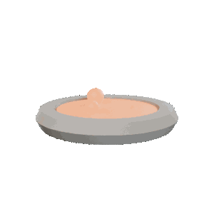
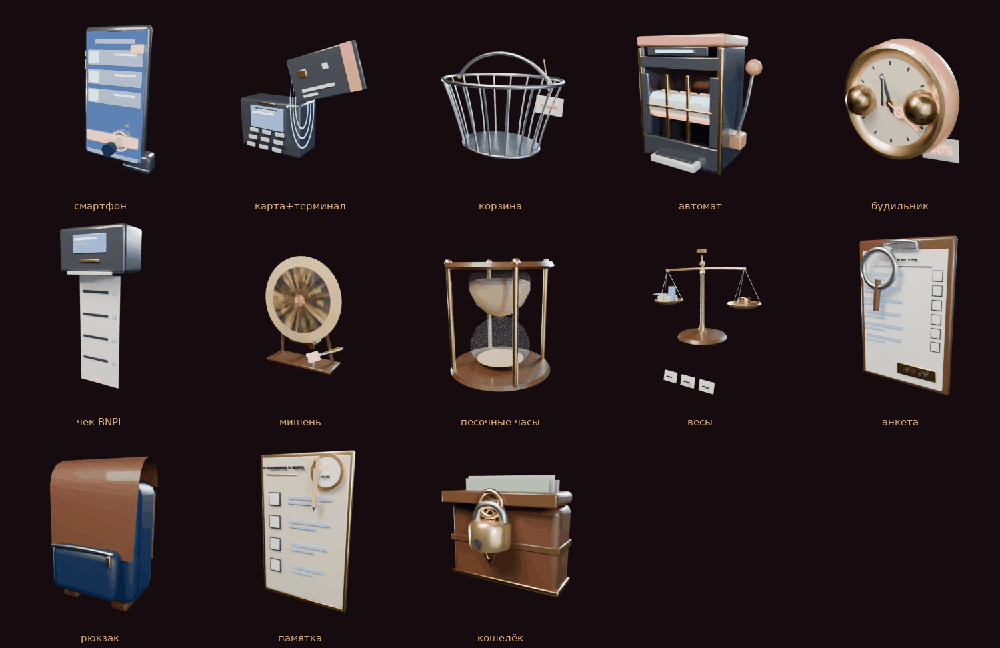

# MyWorkAiBrain — Конвейер живых 3D-презентаций для PowerPoint

-EA7600?style=flat-square&logo=blender&logoColor=white)


Инженерный конвейер, набор эталонных проектов и база знаний, с помощью которых **ИИ-агент (или разработчик) чисто кодом с нуля собирает редактируемые презентации `.pptx` с настоящими анимированными 3D-моделями внутри слайдов** — без ручного моделирования, без видеовставок и без нейросетевых картинок.

<p align="center">
  
</p>

<p align="center">
  
  &nbsp;
  
  &nbsp;
  
</p>

---

## В чём фишка

Обычные «ИИ-презентации» — это либо скучные шаблонные буллеты, либо сплющенные сгенерированные картинки, где нельзя поправить ни одной буквы. Здесь всё иначе:

* **Настоящие 3D-объекты PowerPoint (`am3d:model3d`)** — внутрь `.pptx` вшиваются реальные `.glb`-модели без фона. В редакторе их можно крутить мышкой на 360°, менять ракурс и масштаб.
* **Собственная скелетная анимация деталей (`a3danim:embedAnim`)** — модели не просто вращаются вокруг оси: у сундука поворачивается ключ и откидывается крышка, у арфы вибрируют струны, палец нажимает кнопку «Купить» на смартфоне, крутятся барабаны автомата, извергается вулкан и машет крыльями дракон. При показе слайда PowerPoint запускает эффект «Сцена» (`presetID="100"`) автоматически и крутит бесшовный цикл.
* **Кинематографичный 3D-Morph между слайдами** — экспонаты влетают справа и улетают влево с разворотом в пространстве через закадровые «призраки» (`!!m-...`), а 3D-луидор или шестерня катится по верхней шкале прогресса.
* **100% редактируемая вёрстка и честный фолбэк** — все заголовки, карточки и заметки докладчика нативные. А для старых версий, Google Slides, Keynote, LibreOffice и веб-просмотрщиков внутрь каждого `mc:AlternateContent` автоматически запечён студийный Cycles PNG-рендер в том же ракурсе.
* **Никакого «ИИ-мыла»** — модели строятся процедурной геометрией в Python (`bpy`), фоны, свечения и тени считаются математически (`numpy`), а каждый факт подкреплён таблицей источников.

<details>
<summary><b>Посмотреть живую сетку 3D-экспонатов и раскадровку полной 13-слайдовой презентации</b></summary>
<br>
<p align="center">
  
</p>
<p align="center">
  
</p>
</details>

---

## Как работает конвейер

```text
Blender (Python, headless bpy)              Node.js (pptxgenjs + Chromium)        OpenXML пост-обработка (JSZip)
──────────────────────────────              ──────────────────────────────        ──────────────────────────────
models/make_models.py                       stage.py ──► фон, свет, тень          pptx3d.js:
  └─ процедурные меши + материалы M()       build.js (через lib.js):                ├─ заглушка ──► am3d:model3d + .glb
models/rig.py                                 ├─ единое описание слайдов            ├─ расчёт 3D-камеры по bounding sphere
  └─ кости + запекание anim(t) ──► *.glb      ├─ toPptx() ──► черновой .pptx        ├─ a3danim:embedAnim + авто-«Сцена»
models/render.py                              └─ toHtml() ──► slide-XX.png          ├─ Morph-переходы и каскад появления
  └─ Cycles PNG-постеры (кэш по md5)                                                └─ SHA-1 дедупликация медиа ──► exports/
```

---

## Структура репозитория

| Папка / файл | Роль в проекте |
|---|---|
| **[`AGENTS.md`](AGENTS.md)** | **Инструкция для ИИ-агента (SOP):** пошаговый алгоритм, как с нуля собрать новую 3D-презентацию, проверить её глазами и прогнать валидацию |
| **[`train-ai/`](train-ai/)** | **Глубокий технический учебник (6 глав + демо):** устройство headless Blender без X11/GPU, процедурное моделирование, скелетный риггинг, XML-спецификация `am3d:model3d`, дизайн-система слайдов и полный список граблей |
| **[`presentations/`](presentations/)** | **Примеры презентаций (и общий движок):** исходники 5 эталонных презентаций разных форматов + общие модули (`schumpeter/lib.js`, `pptx3d.js`, `cantillon/models/rig.py`) и CLI-утилиты в `presentations/tools/` |
| **[`exports/`](exports/)** | **Примеры экспорта:** готовые собранные `.pptx`, тексты устных выступлений (`*-script.md`), таблицы источников (`*-sources.md`), контакт-листы слайдов (`*-preview.jpg`) и GIF-анимации (`*-animations-preview.gif`) |

---

## Примеры презентаций (`presentations/`) и примеры экспорта (`exports/`)

В репозитории уже собраны **5 разноплановых проектов** (суммарно **42 слайда** и **более 45 уникальных процедурных 3D-моделей**):

| Проект | Исходники (пример презентации) | Готовый файл (пример экспорта) | Масштаб и начинка |
|---|---|---|---|
| **Ричард Кантильон** | [`presentations/cantillon/`](presentations/cantillon/) | [`exports/cantillon-3d-presentation.pptx`](exports/cantillon-3d-presentation.pptx)<br>[`cantillon-presentation-script.md`](exports/cantillon-presentation-script.md) | **10 слайдов · 10 живых экспонатов XVIII в.**<br>Сундук с ключом и свитком, арфа со струнами, корабль на бегущих волнах, лопающийся пузырь Миссисипи, книга с перелистыванием страниц, весы, игральные кости, круги на воде, компас, свеча с мотыльком |
| **Психология импульсивных трат** | [`presentations/impulse/`](presentations/impulse/) | [`exports/impulse-3d-presentation.pptx`](exports/impulse-3d-presentation.pptx)<br>[`impulse-presentation-script.md`](exports/impulse-presentation-script.md)<br>[`impulse-presentation-sources.md`](exports/impulse-presentation-sources.md) | **13 слайдов · 13 современных 3D-экспонатов**<br>Смартфон с нажатием «Купить», терминал с бесконтактной картой, корзина покупок, слот-автомат «ДОФАМИН», будильник скидок, чек BNPL, мишень с дротиком, песочные часы, весы, планшет-анкета с лупой, рюкзак, памятка 24 ч, кошелёк с замком |
| **Йозеф Шумпетер** | [`presentations/schumpeter/`](presentations/schumpeter/) | [`exports/schumpeter-3d-presentation.pptx`](exports/schumpeter-3d-presentation.pptx)<br>[`schumpeter-presentation-script.md`](exports/schumpeter-presentation-script.md) | **15 слайдов · 14 процедурных 3D-моделей**<br>Паровоз, глобус, колыбель Ньютона, лампа накаливания, стопка книг, цилиндр, шахматный король, катушка, песочные часы + катящаяся шестерня прогресса. Здесь же живёт базовый движок `lib.js` и `pptx3d.js` |
| **Три чуда (`wow`)** | [`presentations/wow/`](presentations/wow/) | [`exports/wow-3d-wonders.pptx`](exports/wow-3d-wonders.pptx)<br>[`wow-wonders-script.md`](exports/wow-wonders-script.md) | **3 слайда · шоурил сложных сцен**<br>Маяк с двумя вращающимися лучами, волнами и парящей чайкой (14 костей), ярмарочная карусель со скачущими лошадками (5 костей), торнадо из 6 колец с обломками и молнией (15 костей) |
| **Остров огня (`fun`)** | [`presentations/fun/`](presentations/fun/) | [`exports/fun-fire-island.pptx`](exports/fun-fire-island.pptx)<br>[`fun-fire-island-script.md`](exports/fun-fire-island-script.md) | **1 фан-слайд · 5 живых моделей сразу (64 кости)**<br>Диорама извергающегося вулкана с орбитальным огнедышащим драконом и буквами `INFERNO` в окружении двух пылающих факелов и двух кипящих лава-чаш |

Минимальный учебный пример всего конвейера на ~100 строк кода (шкатулка с откидной крышкой и подпрыгивающей монетой → однослайдовый `demo.pptx`) лежит в [`train-ai/examples/`](train-ai/examples/).

---

## Как дать задачу ИИ-агенту

Подключи репозиторий к своему кодинг-агенту и дай запрос в свободной форме — агент сам прочитает [`AGENTS.md`](AGENTS.md) и [`train-ai/`](train-ai/):

```text
Прочитай AGENTS.md и train-ai/, посмотри примеры в presentations/ и exports/.
Собери новую 3D-презентацию на тему «<ТВОЯ ТЕМА>» на <10> слайдов:
на каждом слайде — свой процедурный анимированный 3D-экспонат, Morph-переходы,
заметки докладчика, проверенные источники, превью слайдов и GIF анимаций в exports/.
```

---

## Быстрый старт и команды сборки

### 1. Поднять окружение (один раз на контейнер / машину)

Скрипт устанавливает headless Blender (`bpy`), собирает легковесные X11/GL-заглушки в `/tmp/bstub` (работает без `apt`, без X-сервера и без GPU), ставит Python-пакеты и `node_modules`:

```bash
bash presentations/tools/setup-env.sh
# В конце выведет: bpy 5.x.x и SETUP_DONE
```

### 2. Собрать минимальный пример за две команды

```bash
LD_LIBRARY_PATH=/tmp/bstub python3 train-ai/examples/box_with_lid.py   # → train-ai/examples/out/box.glb
node train-ai/examples/mini_deck.js                                    # → train-ai/examples/out/demo.pptx
```

### 3. Пересобрать любую презентацию и проверить результат

```bash
cd presentations/cantillon
LD_LIBRARY_PATH=/tmp/bstub python3 models/make_models.py               # пересобрать все .glb (или конкретные ключи)
LD_LIBRARY_PATH=/tmp/bstub python3 models/anim_preview.py chest ship   # проверить анимацию .glb в GIF/раскадровке
python3 stage.py                                                       # сгенерировать фон сцены, свечение и тень
node build.js --preview                                                # собрать .pptx в exports/ + PNG слайдов
cd ../..

# Собрать контакт-лист всех слайдов и провалидировать структуру .pptx:
python3 presentations/tools/contact-sheet.py presentations/cantillon/preview exports/cantillon-preview.jpg
python3 presentations/tools/validate-pptx.py exports/cantillon-3d-presentation.pptx --expect-slides 10
```

> **Совет для быстрой вёрстки:** запуск `FAST=1 node build.js --preview --only=1,3` рендерит черновые растры в низком разрешении и снимает скриншоты только выбранных слайдов за секунды.

---

## Совместимость `.pptx`

| Среда открытия | 3D-модели (вращение мышью) | Анимация частей модели («Сцена») | Переходы Morph | Текст, верстка и заметки |
|---|:---:|:---:|:---:|:---:|
| **PowerPoint 365 / 2021+ (Windows, macOS)** | Да (нативно) | Да (автоцикл) | Да (3D Morph) | Полностью редактируемые |
| **PowerPoint 2019** | Да | Частично / постер | Да | Полностью редактируемые |
| **Старый PowerPoint, Keynote, Google Slides, LibreOffice, Moodle** | Авто-фолбэк в Cycles PNG | Статичный постер кадра 0 | Авто-фолбэк в Fade | Полностью сохраняются |
